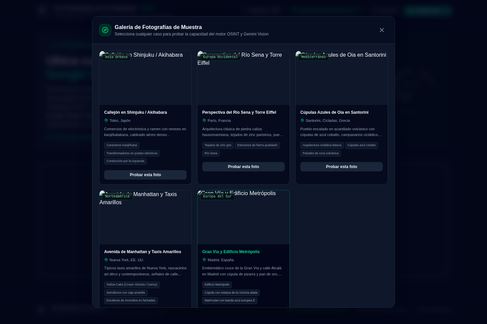
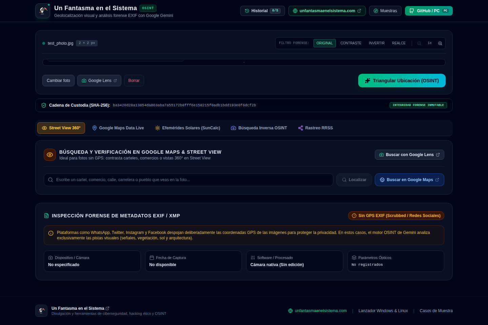

# 🌍 GeoSpecter OSINT (Web) - Visual & EXIF Photo Geolocation
### Creado por [Un Fantasma en el Sistema](https://www.unfantasmaenelsistema.com/)

Versión **web estática** (GitHub Pages) de la herramienta de geolocalización e inteligencia geoespacial (GEOINT / OSINT). Se usa directamente desde el navegador, sin instalar nada. Permite cargar cualquier fotografía y deducir su ubicación en el mapa combinando **metadatos forenses EXIF** y el poder de **Google Gemini 3.8 Flash Multimodal Vision**.

> 💻 ¿Prefieres ejecutarla en tu equipo con la API key en un `.env`? Usa la versión local: [ghost-image-locator](https://github.com/unfantasmaenelsistema/ghost-image-locator).

Sitio Web Oficial: [www.unfantasmaenelsistema.com](https://www.unfantasmaenelsistema.com/)

---

## 🖼️ Capturas de Pantalla

<table>
  <tr>
    <td></td>
    <td></td>
  </tr>
  <tr>
    <td colspan="2"></td>
  </tr>
</table>

---

## ⚡ Características Principales

1. **Doble Motor de Detección:**
   - **Motor 1 (Forense EXIF/XMP):** Si la fotografía fue tomada con un móvil o cámara con GPS activado y no ha sido limpiada por redes sociales, extrae directamente las coordenadas de hardware WGS84, fecha y hora exacta, modelo de cámara y parámetros ópticos.
   - **Motor 2 (Inteligencia Visual Google Gemini):** Si la foto no tiene GPS o para contrastarla, Gemini 3.8 Flash analiza bolardos viales específicos de cada país, tipos de matrículas, arquitectura y tejados, flora y bioma climático, sentido de circulación (izquierda vs derecha), señalética, idioma y ángulo solar con sombras.
2. **Mapa Interactivo Multicapa (Leaflet):**
   - Modo Táctico Oscuro (Esri Dark Gray Canvas).
   - Modo Satélite de Alta Resolución (Esri World Imagery) para examinar azoteas y carreteras reales.
   - Modo Calles y Carreteras (OpenStreetMap).
   - Visualización de radio de incertidumbre y línea de discrepancia entre EXIF e IA.
   - Acceso directo a **Google Maps**, **Google Street View** y **Google Earth 3D**.
3. **Visor de Imágenes con Filtros Forenses:**
   - Filtro de Alto Contraste (para leer letreros o matrículas lejanas).
   - Inversión de Color (para textos tenues o grafitis).
   - Realce de Bordes y zoom óptico hasta 3x.
4. **Cronolocalización (hora y estación estimadas):**
   - Deduce la ventana horaria por la inclinación y proporción de las sombras.
   - Deduce la estación del año por el estado fenológico de la vegetación (hojas, nieve, floración).
   - Cruza ambos vectores en un dictamen forense conjunto.
5. **Rastreo OSINT en Redes Sociales:**
   - Genera términos de búsqueda óptimos para X, Instagram y Reddit.
   - Lanza un escaneo en vivo contra fuentes abiertas desde la propia app.
   - Atajos directos a Yandex, Google Lens, Bing Visual Search y TinEye para búsqueda inversa de imagen.
6. **Dossier e Informes Exportables:**
   - Informe pericial en **PDF** con cadena de custodia, hash SHA-256, pistas visuales y enlaces de auditoría.
   - Exportación en **GeoJSON** y **KML** (compatible con Google Earth y cualquier SIG).
   - Historial local de las últimas 5 investigaciones (guardado en el navegador, no sale de tu equipo).
7. **Web estática, sin backend:**
   - Cada usuario usa **su propia API key de Gemini**, que se guarda solo en su navegador.
   - Despliegue automático en GitHub Pages con GitHub Actions.

---

## 🧭 Cómo se usa

0. **Introduce tu API key** de Gemini con el botón **"API Key"** de la barra superior (solo la primera vez).
1. **Carga una foto**: arrástrala a la zona de subida, pégala con `Ctrl+V` o elige una de la galería de muestras incluida.
2. **GeoSpecter analiza la imagen** en dos pasadas: primero intenta leer GPS nativo del EXIF; si no hay, o para contrastarlo, envía la imagen a Gemini junto con las pistas visuales del entorno.
3. **Revisa el dictamen**: ubicación, radio de incertidumbre, cronolocalización (hora/estación) y cada pista visual individual con su nivel de impacto (`CRITICAL` / `STRONG` / `SUPPORTING`).
4. **Verifica en el mapa**: cambia entre capa táctica, satélite o calles, y salta directo a Google Street View o Google Earth 3D sobre el punto estimado.
5. **Lanza el rastreo social** (opcional) para buscar dónde se publicó la imagen originalmente, usando los términos clave sugeridos.
6. **Exporta el caso**: PDF pericial para informe, o GeoJSON/KML si vas a cruzar el punto con otras herramientas SIG/OSINT.

---

## 🔑 Tu API key de Gemini

Pulsa **"API Key"** en la barra superior y pega tu clave (gratis en [Google AI Studio](https://aistudio.google.com/apikey)).

- Se guarda **solo en tu navegador**: en `localStorage` si marcas "Recordar", o en `sessionStorage` (se borra al cerrar la pestaña) si no. Puedes borrarla en cualquier momento con **"Olvidar"**.
- Las peticiones van **directamente de tu navegador a la API de Google** (`generativelanguage.googleapis.com`). Esta web no tiene servidor y nunca ve tu clave.
- La página incluye una Content-Security-Policy que solo permite conectar con Google Gemini, Nominatim y las fuentes de imágenes/mapas usadas.
- Recomendado: usa una clave dedicada, restringida a la API "Generative Language" y con límite de cuota. En equipos compartidos, no marques "Recordar".

---

## 🚀 Despliegue en GitHub Pages

1. Haz fork o sube este repositorio a tu cuenta de GitHub.
2. Ve a *Settings → Pages → Build and deployment → Source* y elige **GitHub Actions**.
3. Cada push a `main` ejecuta `.github/workflows/deploy-pages.yml` y publica la web en `https://<usuario>.github.io/<repo>/`.

El build usa rutas relativas, así que funciona con cualquier nombre de repositorio.

### Desarrollo local (opcional)
```bash
npm install
npm run dev
```
Para probar el build de producción: `npm run build && npm run preview`.

---

## 🩺 Solución de Problemas

**Error `La API key de Gemini no es válida`**
Revisa la clave en el botón "API Key". Si la restringiste por referente HTTP en Google Cloud, añade el dominio `https://<usuario>.github.io/*`.

**Error de cuota (`429` / `RESOURCE_EXHAUSTED`)**
Has agotado el límite gratuito de tu clave. Espera unos minutos o revisa tu plan en Google AI Studio.

**La clave desaparece al cerrar el navegador**
No marcaste "Recordar", o el navegador borra los datos del sitio al salir (modo privado, limpieza automática).

**El mapa en modo "Táctico" sale negro con marcas de agua "API KEY REQUIRED"**
Esta versión usa el basemap `World_Dark_Gray_Base` de Esri (gratuito, sin API key); si lo ves, asegúrate de estar en la última versión de `main`.

---

## 🛠️ Tecnologías Empleadas
- **Frontend:** React 19, TypeScript, Tailwind CSS, Leaflet, Lucide Icons, Motion.
- **Hosting:** GitHub Pages (estático, sin backend), Vite.
- **IA y Visión Espacial:** `@google/genai` (Gemini 3.8 Flash).
- **Filtros Forenses EXIF:** `exifr`.
- **Mapas y Cartografía:** Leaflet, Esri (satélite y basemap táctico), OpenStreetMap.
- **Informes:** `jspdf` (dossier pericial en PDF), exportación nativa a GeoJSON y KML.

---

## 📄 Licencia
Distribuido bajo licencia MIT. Desarrollado con fines de investigación OSINT, formativos y educativos.
